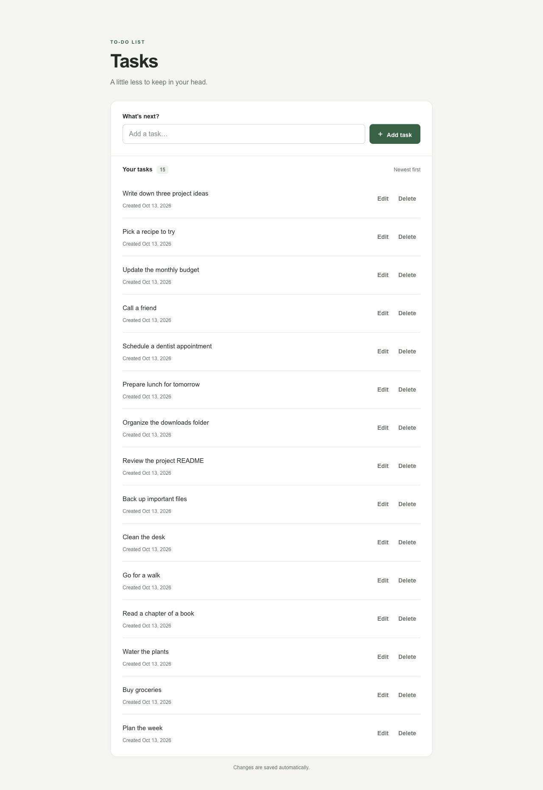
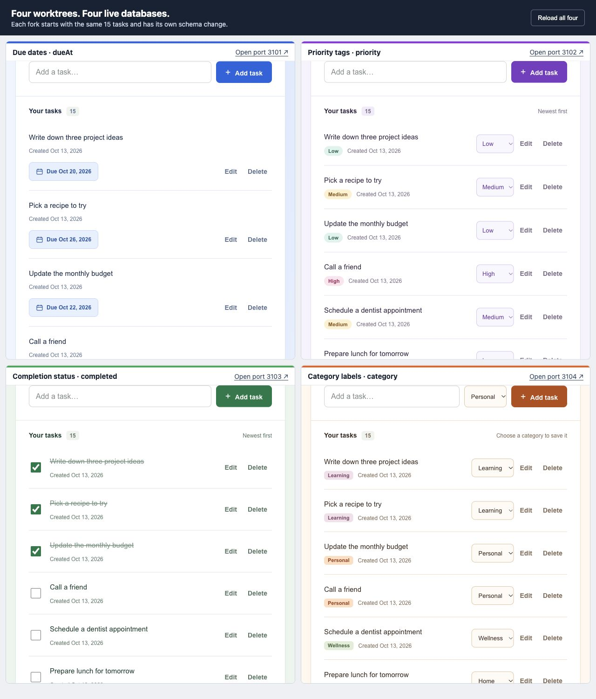
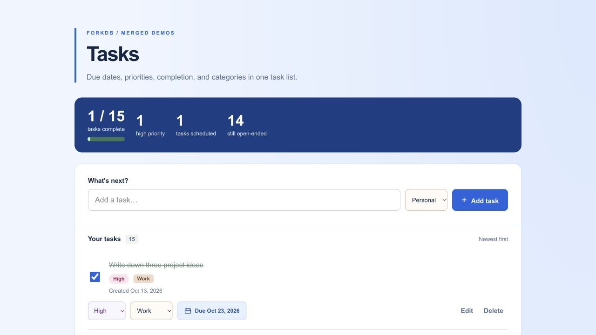

# Database baseline for the ForkDB demo

Captured on October 12, 2026 at 7:28:26 PM PDT. This is the source database before creating the four database forks and their Git worktrees.

## Source database

- Database: `forkdb_tasks`
- PostgreSQL endpoint: `127.0.0.1:55433`
- Schema: `public`
- Application table: `tasks`, with **15 rows**
- Prisma migration table: `_prisma_migrations`, with 1 row
- Snapshot timestamp in UTC: `2026-10-13T02:28:26.045Z`

The table below contains every application row read directly from PostgreSQL. Creation timestamps use UTC. The screenshot also displays dates in UTC, so its October 13 date corresponds to the evening of October 12 in Los Angeles.

## App screenshot

The running app at [127.0.0.1:3000](http://127.0.0.1:3000) displays these same 15 tasks. This screenshot is saved alongside this document so it can travel with the repository.



## Task schema

```prisma
generator client {
  provider = "prisma-client"
  output   = "../src/generated/prisma"
}

datasource db {
  provider = "postgresql"
}

model Task {
  id        String   @id @default(uuid()) @db.Uuid
  name      String   @db.VarChar(200)
  createdAt DateTime @default(now()) @db.Timestamptz(3)

  @@map("tasks")
}
```

## Complete task contents

Rows follow the app's order, newest first, with descending IDs to break timestamp ties. All examples were inserted in one batch, so they share a creation timestamp.

| ID | Name | Created at, UTC |
| --- | --- | --- |
| `d769a3c0-30fd-4b7b-8d95-000000000015` | Write down three project ideas | `2026-10-13T02:25:34.107Z` |
| `d769a3c0-30fd-4b7b-8d95-000000000014` | Pick a recipe to try | `2026-10-13T02:25:34.107Z` |
| `d769a3c0-30fd-4b7b-8d95-000000000013` | Update the monthly budget | `2026-10-13T02:25:34.107Z` |
| `d769a3c0-30fd-4b7b-8d95-000000000012` | Call a friend | `2026-10-13T02:25:34.107Z` |
| `d769a3c0-30fd-4b7b-8d95-000000000011` | Schedule a dentist appointment | `2026-10-13T02:25:34.107Z` |
| `d769a3c0-30fd-4b7b-8d95-000000000010` | Prepare lunch for tomorrow | `2026-10-13T02:25:34.107Z` |
| `d769a3c0-30fd-4b7b-8d95-000000000009` | Organize the downloads folder | `2026-10-13T02:25:34.107Z` |
| `d769a3c0-30fd-4b7b-8d95-000000000008` | Review the project README | `2026-10-13T02:25:34.107Z` |
| `d769a3c0-30fd-4b7b-8d95-000000000007` | Back up important files | `2026-10-13T02:25:34.107Z` |
| `d769a3c0-30fd-4b7b-8d95-000000000006` | Clean the desk | `2026-10-13T02:25:34.107Z` |
| `d769a3c0-30fd-4b7b-8d95-000000000005` | Go for a walk | `2026-10-13T02:25:34.107Z` |
| `d769a3c0-30fd-4b7b-8d95-000000000004` | Read a chapter of a book | `2026-10-13T02:25:34.107Z` |
| `d769a3c0-30fd-4b7b-8d95-000000000003` | Water the plants | `2026-10-13T02:25:34.107Z` |
| `d769a3c0-30fd-4b7b-8d95-000000000002` | Buy groceries | `2026-10-13T02:25:34.107Z` |
| `d769a3c0-30fd-4b7b-8d95-000000000001` | Plan the week | `2026-10-13T02:25:34.107Z` |

## Prisma migration contents

This is the complete migration tracking row. It is Prisma's internal metadata; the application has no users or other domain tables.

```json
[
  {
    "id": "b82a1682-b858-4bba-8bb1-82a41cba42ea",
    "checksum": "9c12759ef0b4a5e0fd1dd9d1c4ff50accaaad236013da4136773275ee76e7d44",
    "finished_at": "2026-10-13T02:20:53.299Z",
    "migration_name": "20261013022053_init",
    "logs": null,
    "rolled_back_at": null,
    "started_at": "2026-10-13T02:20:53.297Z",
    "applied_steps_count": 1
  }
]
```

## Four running forks

Each of four Codex chats created its own branch-backed Git worktree. ForkDB copied the same populated PostgreSQL source into four distinct databases and wrote a separate ignored `.env` in each worktree. Each branch then applied one saved Prisma migration and changed only its own added field.

The first checkout-hook attempts failed because Prisma's `?schema=public` URL parameter was passed to `pg_dump`, which rejects it. After fixing the CLI to omit that application-only parameter for PostgreSQL dump/restore, `dbfork-proto sync --all` successfully created all four full copies. This run demonstrates CLI recovery after a hook failure, rather than claiming the original hook attempts succeeded.

The following contents were read directly from all four databases on October 12, 2026 at 07:48:08 PM PDT. Snapshot timestamp in UTC: `2026-10-13T02:48:08.299Z`. Each fork contained exactly 15 tasks, and every original ID, name, and creation timestamp matched the source baseline above. Each had its own additional column, with no extra columns from the other branches. The source still had its original three-column schema at capture time.

[Complete machine-readable rows, schema metadata, migration names, and branch commits](data/fork-snapshots.json). Connection URLs and credentials are excluded.



Each live panel is scrolled to its task list so the same copied task names and each fork's distinct field values are visible together. The labels identify the added database column in each fork.

The comparison page embeds the four live app servers at [127.0.0.1:3100](http://127.0.0.1:3100). Its [HTML source](four-forks.html) can be served with `python3 -m http.server 3100 --bind 127.0.0.1 --directory docs` and opened at `/four-forks.html` while the four app servers are running.

| Fork | Branch commit | App | Added column |
| --- | --- | --- | --- |
| Due dates | [`b313e62`](https://github.com/xavierloeraflores/forkdb-proto-test-case/commit/b313e62d1d07601179279f1d20bbc03369bc1d45) | [Port 3101](http://127.0.0.1:3101) | `dueAt` |
| Priority | [`388e198`](https://github.com/xavierloeraflores/forkdb-proto-test-case/commit/388e1988ccbb63b811e72d422a0d967c7e9b60b5) | [Port 3102](http://127.0.0.1:3102) | `priority` |
| Completion | [`1073b21`](https://github.com/xavierloeraflores/forkdb-proto-test-case/commit/1073b21959f9fa67a0d6ec059eddbb41cbd3af85) | [Port 3103](http://127.0.0.1:3103) | `completed` |
| Categories | [`9b9dda1`](https://github.com/xavierloeraflores/forkdb-proto-test-case/commit/9b9dda159d7d037b089adaafa1bd278745a670e2) | [Port 3104](http://127.0.0.1:3104) | `category` |

### Due dates branch

Branch: `feat/forkdb-demo-due-dates`. Database: `dbf_dd653853f244316e7fe5976421a28f97`. Worktree: `/tmp/forkdb-demo-due-dates`.

Saved migration: [`20261013030000_add_due_at`](../prisma/migrations/20261013030000_add_due_at/migration.sql).

```sql
-- Add optional due dates while preserving every existing task.
ALTER TABLE "tasks" ADD COLUMN "dueAt" TIMESTAMPTZ(3);
```

The blue app has date chips and a date editor. `dueAt` is nullable; saving dates uses midnight UTC.

Complete `tasks` contents, including this branch's `dueAt` values:

| ID | Name | Created at, UTC | dueAt |
| --- | --- | --- | --- |
| `d769a3c0-30fd-4b7b-8d95-000000000015` | Write down three project ideas | `2026-10-13T02:25:34.107Z` | `2026-10-20T00:00:00.000Z` |
| `d769a3c0-30fd-4b7b-8d95-000000000014` | Pick a recipe to try | `2026-10-13T02:25:34.107Z` | `2026-10-26T00:00:00.000Z` |
| `d769a3c0-30fd-4b7b-8d95-000000000013` | Update the monthly budget | `2026-10-13T02:25:34.107Z` | `2026-10-22T00:00:00.000Z` |
| `d769a3c0-30fd-4b7b-8d95-000000000012` | Call a friend | `2026-10-13T02:25:34.107Z` | `2026-10-19T00:00:00.000Z` |
| `d769a3c0-30fd-4b7b-8d95-000000000011` | Schedule a dentist appointment | `2026-10-13T02:25:34.107Z` | `null` |
| `d769a3c0-30fd-4b7b-8d95-000000000010` | Prepare lunch for tomorrow | `2026-10-13T02:25:34.107Z` | `2026-10-14T00:00:00.000Z` |
| `d769a3c0-30fd-4b7b-8d95-000000000009` | Organize the downloads folder | `2026-10-13T02:25:34.107Z` | `2026-10-13T00:00:00.000Z` |
| `d769a3c0-30fd-4b7b-8d95-000000000008` | Review the project README | `2026-10-13T02:25:34.107Z` | `2026-10-12T00:00:00.000Z` |
| `d769a3c0-30fd-4b7b-8d95-000000000007` | Back up important files | `2026-10-13T02:25:34.107Z` | `2026-10-26T00:00:00.000Z` |
| `d769a3c0-30fd-4b7b-8d95-000000000006` | Clean the desk | `2026-10-13T02:25:34.107Z` | `null` |
| `d769a3c0-30fd-4b7b-8d95-000000000005` | Go for a walk | `2026-10-13T02:25:34.107Z` | `2026-10-19T00:00:00.000Z` |
| `d769a3c0-30fd-4b7b-8d95-000000000004` | Read a chapter of a book | `2026-10-13T02:25:34.107Z` | `2026-10-16T00:00:00.000Z` |
| `d769a3c0-30fd-4b7b-8d95-000000000003` | Water the plants | `2026-10-13T02:25:34.107Z` | `2026-10-14T00:00:00.000Z` |
| `d769a3c0-30fd-4b7b-8d95-000000000002` | Buy groceries | `2026-10-13T02:25:34.107Z` | `2026-10-13T00:00:00.000Z` |
| `d769a3c0-30fd-4b7b-8d95-000000000001` | Plan the week | `2026-10-13T02:25:34.107Z` | `null` |

### Priority branch

Branch: `feat/forkdb-demo-priority`. Database: `dbf_83e7ada09fe80c2a9c929619174c067b`. Worktree: `/tmp/forkdb-demo-priority`.

Saved migration: [`20261013033000_add_task_priority`](../prisma/migrations/20261013033000_add_task_priority/migration.sql).

```sql
CREATE TYPE "Priority" AS ENUM ('LOW', 'MEDIUM', 'HIGH');

ALTER TABLE "tasks" ADD COLUMN "priority" "Priority" NOT NULL DEFAULT 'MEDIUM';
```

The purple app has priority badges and selectors. `priority` is a required PostgreSQL enum with `LOW`, `MEDIUM`, and `HIGH` values, defaulting to `MEDIUM`.

Complete `tasks` contents, including this branch's `priority` values:

| ID | Name | Created at, UTC | priority |
| --- | --- | --- | --- |
| `d769a3c0-30fd-4b7b-8d95-000000000015` | Write down three project ideas | `2026-10-13T02:25:34.107Z` | `LOW` |
| `d769a3c0-30fd-4b7b-8d95-000000000014` | Pick a recipe to try | `2026-10-13T02:25:34.107Z` | `MEDIUM` |
| `d769a3c0-30fd-4b7b-8d95-000000000013` | Update the monthly budget | `2026-10-13T02:25:34.107Z` | `LOW` |
| `d769a3c0-30fd-4b7b-8d95-000000000012` | Call a friend | `2026-10-13T02:25:34.107Z` | `HIGH` |
| `d769a3c0-30fd-4b7b-8d95-000000000011` | Schedule a dentist appointment | `2026-10-13T02:25:34.107Z` | `MEDIUM` |
| `d769a3c0-30fd-4b7b-8d95-000000000010` | Prepare lunch for tomorrow | `2026-10-13T02:25:34.107Z` | `LOW` |
| `d769a3c0-30fd-4b7b-8d95-000000000009` | Organize the downloads folder | `2026-10-13T02:25:34.107Z` | `HIGH` |
| `d769a3c0-30fd-4b7b-8d95-000000000008` | Review the project README | `2026-10-13T02:25:34.107Z` | `MEDIUM` |
| `d769a3c0-30fd-4b7b-8d95-000000000007` | Back up important files | `2026-10-13T02:25:34.107Z` | `LOW` |
| `d769a3c0-30fd-4b7b-8d95-000000000006` | Clean the desk | `2026-10-13T02:25:34.107Z` | `HIGH` |
| `d769a3c0-30fd-4b7b-8d95-000000000005` | Go for a walk | `2026-10-13T02:25:34.107Z` | `MEDIUM` |
| `d769a3c0-30fd-4b7b-8d95-000000000004` | Read a chapter of a book | `2026-10-13T02:25:34.107Z` | `LOW` |
| `d769a3c0-30fd-4b7b-8d95-000000000003` | Water the plants | `2026-10-13T02:25:34.107Z` | `HIGH` |
| `d769a3c0-30fd-4b7b-8d95-000000000002` | Buy groceries | `2026-10-13T02:25:34.107Z` | `MEDIUM` |
| `d769a3c0-30fd-4b7b-8d95-000000000001` | Plan the week | `2026-10-13T02:25:34.107Z` | `LOW` |

### Completion branch

Branch: `feat/forkdb-demo-completion`. Database: `dbf_da5ad13027ae3dc5a152650a1d7f2c3a`. Worktree: `/tmp/forkdb-demo-completion`.

Saved migration: [`20261013030000_add_task_completed`](../prisma/migrations/20261013030000_add_task_completed/migration.sql).

```sql
ALTER TABLE "tasks" ADD COLUMN "completed" BOOLEAN NOT NULL DEFAULT false;
```

The green app has checkboxes, crossed-out completed tasks, and a progress summary. `completed` is required and defaults to `false`.

Complete `tasks` contents, including this branch's `completed` values:

| ID | Name | Created at, UTC | completed |
| --- | --- | --- | --- |
| `d769a3c0-30fd-4b7b-8d95-000000000015` | Write down three project ideas | `2026-10-13T02:25:34.107Z` | `true` |
| `d769a3c0-30fd-4b7b-8d95-000000000014` | Pick a recipe to try | `2026-10-13T02:25:34.107Z` | `true` |
| `d769a3c0-30fd-4b7b-8d95-000000000013` | Update the monthly budget | `2026-10-13T02:25:34.107Z` | `true` |
| `d769a3c0-30fd-4b7b-8d95-000000000012` | Call a friend | `2026-10-13T02:25:34.107Z` | `false` |
| `d769a3c0-30fd-4b7b-8d95-000000000011` | Schedule a dentist appointment | `2026-10-13T02:25:34.107Z` | `false` |
| `d769a3c0-30fd-4b7b-8d95-000000000010` | Prepare lunch for tomorrow | `2026-10-13T02:25:34.107Z` | `false` |
| `d769a3c0-30fd-4b7b-8d95-000000000009` | Organize the downloads folder | `2026-10-13T02:25:34.107Z` | `false` |
| `d769a3c0-30fd-4b7b-8d95-000000000008` | Review the project README | `2026-10-13T02:25:34.107Z` | `false` |
| `d769a3c0-30fd-4b7b-8d95-000000000007` | Back up important files | `2026-10-13T02:25:34.107Z` | `false` |
| `d769a3c0-30fd-4b7b-8d95-000000000006` | Clean the desk | `2026-10-13T02:25:34.107Z` | `false` |
| `d769a3c0-30fd-4b7b-8d95-000000000005` | Go for a walk | `2026-10-13T02:25:34.107Z` | `false` |
| `d769a3c0-30fd-4b7b-8d95-000000000004` | Read a chapter of a book | `2026-10-13T02:25:34.107Z` | `false` |
| `d769a3c0-30fd-4b7b-8d95-000000000003` | Water the plants | `2026-10-13T02:25:34.107Z` | `false` |
| `d769a3c0-30fd-4b7b-8d95-000000000002` | Buy groceries | `2026-10-13T02:25:34.107Z` | `false` |
| `d769a3c0-30fd-4b7b-8d95-000000000001` | Plan the week | `2026-10-13T02:25:34.107Z` | `false` |

### Categories branch

Branch: `feat/forkdb-demo-categories`. Database: `dbf_756bbfe50c83e0ad96f48d1034fc191c`. Worktree: `/tmp/forkdb-demo-categories`.

Saved migration: [`20261013030000_add_task_category`](../prisma/migrations/20261013030000_add_task_category/migration.sql).

```sql
ALTER TABLE "tasks" ADD COLUMN "category" VARCHAR(32) NOT NULL DEFAULT 'Personal';
```

The orange app has category chips and selectors. `category` is a required varchar(32), defaulting to `Personal`. The app validates Personal, Home, Work, Wellness, and Learning.

Complete `tasks` contents, including this branch's `category` values:

| ID | Name | Created at, UTC | category |
| --- | --- | --- | --- |
| `d769a3c0-30fd-4b7b-8d95-000000000015` | Write down three project ideas | `2026-10-13T02:25:34.107Z` | `Learning` |
| `d769a3c0-30fd-4b7b-8d95-000000000014` | Pick a recipe to try | `2026-10-13T02:25:34.107Z` | `Learning` |
| `d769a3c0-30fd-4b7b-8d95-000000000013` | Update the monthly budget | `2026-10-13T02:25:34.107Z` | `Personal` |
| `d769a3c0-30fd-4b7b-8d95-000000000012` | Call a friend | `2026-10-13T02:25:34.107Z` | `Personal` |
| `d769a3c0-30fd-4b7b-8d95-000000000011` | Schedule a dentist appointment | `2026-10-13T02:25:34.107Z` | `Wellness` |
| `d769a3c0-30fd-4b7b-8d95-000000000010` | Prepare lunch for tomorrow | `2026-10-13T02:25:34.107Z` | `Home` |
| `d769a3c0-30fd-4b7b-8d95-000000000009` | Organize the downloads folder | `2026-10-13T02:25:34.107Z` | `Work` |
| `d769a3c0-30fd-4b7b-8d95-000000000008` | Review the project README | `2026-10-13T02:25:34.107Z` | `Work` |
| `d769a3c0-30fd-4b7b-8d95-000000000007` | Back up important files | `2026-10-13T02:25:34.107Z` | `Work` |
| `d769a3c0-30fd-4b7b-8d95-000000000006` | Clean the desk | `2026-10-13T02:25:34.107Z` | `Home` |
| `d769a3c0-30fd-4b7b-8d95-000000000005` | Go for a walk | `2026-10-13T02:25:34.107Z` | `Wellness` |
| `d769a3c0-30fd-4b7b-8d95-000000000004` | Read a chapter of a book | `2026-10-13T02:25:34.107Z` | `Learning` |
| `d769a3c0-30fd-4b7b-8d95-000000000003` | Water the plants | `2026-10-13T02:25:34.107Z` | `Home` |
| `d769a3c0-30fd-4b7b-8d95-000000000002` | Buy groceries | `2026-10-13T02:25:34.107Z` | `Home` |
| `d769a3c0-30fd-4b7b-8d95-000000000001` | Plan the week | `2026-10-13T02:25:34.107Z` | `Personal` |

## Verification and merge behavior

All four branches passed lint, TypeScript checks, production builds, HTTP 200 checks, and browser save-and-reload checks for their respective fields. The database comparison verified all 15 original IDs, names, and creation times before and after the branch-specific changes. The screenshot was taken while all four independent production servers were running.

The four feature commits are preserved and merged into `main`, with conflict resolution that combines all four controls and retains all four migration files. The merged Task model contains `id`, `name`, `createdAt`, `dueAt`, `priority`, `completed`, and `category`. The original four worktrees stay on their individual branch commits, so their servers and schema variants remain independently runnable.

Git merges code and migration files. It does **not** merge live database contents. Applying `pnpm db:deploy` to the main database adds the four columns with their defaults; the example due dates, priorities, completion marks, and categories in the fork snapshots remain specific to their databases. The source baseline above is historical, before these additive migrations. No baseline task names, IDs, or creation times are changed by these migrations.

Do not run `pnpm db:seed` on the fork demos. Their rows came from the populated source through ForkDB, not four independent seed runs. The committed JSON records the demo values for reference; it is not an automatic restore or backfill script.

### Integrated app check

The combined controls were also tested on a separate ForkDB validation database. One original task was marked complete, assigned High priority and the Work category, and given an October 23, 2026 due date. All four values survived a browser reload and matched PostgreSQL. The original 15 IDs, names, and creation times remained unchanged, and all four demo database snapshots still matched exactly.


